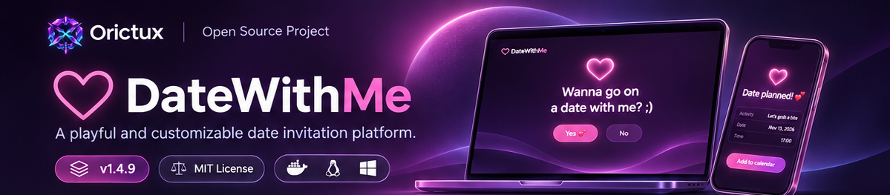
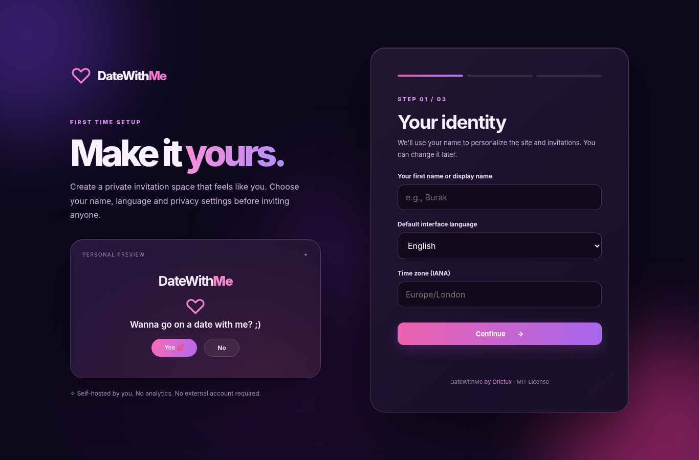
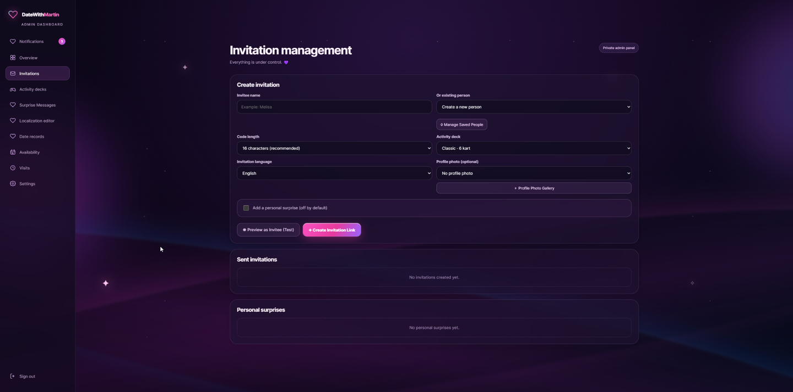
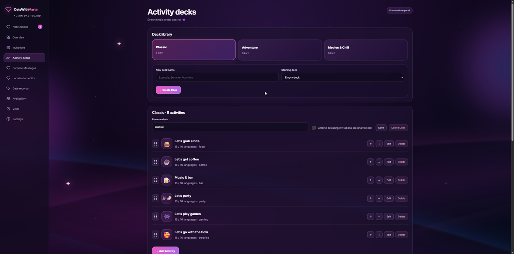
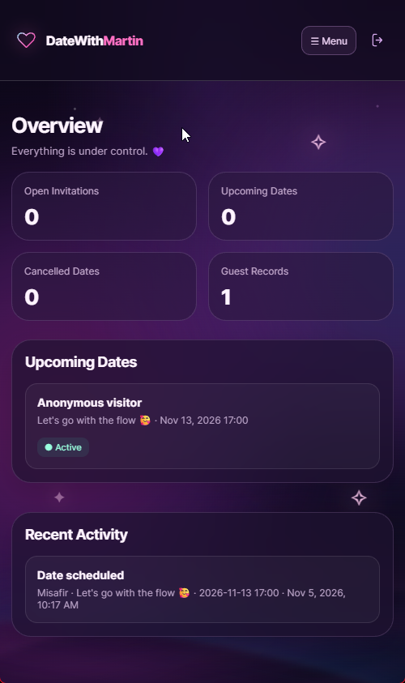
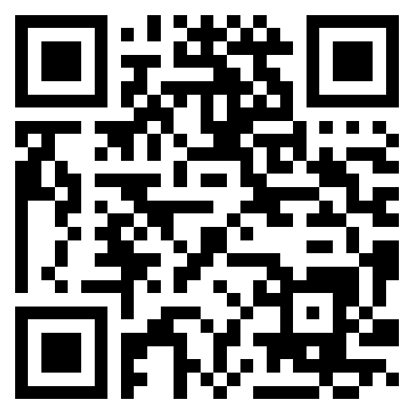

<div align="center">


# DateWithMe

**A playful, customizable date invitation website. Free, open source, and yours to host.**



[](https://github.com/orictux/datewithme/releases/tag/v1.4.9)
[](#features)
[](#quick-start)
[](docs/DEPLOYMENT.md)
[](#deployment-options)
[](#deployment-options)
[](LICENSE)
[](#support-development)

**Created by [Orictux](https://orictux.com)**

</div>

## The story

DateWithMe was never supposed to become a full application.

It started with a joke. Friends kept sending me videos from the "POV: you're dating an IT guy" trend, and I kept seeing them on social media. In those clips, an IT guy builds a tiny website asking someone out. The joke is simple: when the other person reaches for **No**, the button runs away or refuses to be clicked.

One day, with nothing better to do, I thought, *I should build one of these myself.*

So I did.

Then I kept adding things. Maybe a few too many.

A tiny joke with two buttons became a customizable invitation system with activity decks, scheduling, private invitations, personal surprises, notifications, and a proper administration dashboard. The runaway **No** button is still the signature feature. It is enabled by default, and the site owner can disable it in Settings.

DateWithMe is now free and open source so anyone can set up their own version, personalize it, and have some fun with it.

## What is DateWithMe?

DateWithMe is a self-hostable web application for making personalized, interactive invitations. It is not a dating network or an account-based dating service. One person hosts an installation, chooses their name and preferences, then shares invitation links with the people they want to invite.

The first-run setup wizard personalizes the interface around the owner's display name, such as `DateWithAlex`. A domain is optional. You can start locally and configure an HTTPS address later.

<div align="center">



<sub>First-run setup wizard. Screenshots below are from local development and test installations.</sub>

</div>

## Features

| Experience | Administration and customization |
| :--- | :--- |
| Runaway No button, enabled by default | Turn the playful button behavior on or off |
| Private invitation links | Create, preview, edit and manage invitations |
| Activity choices and date planning | Reusable activity decks, card library and drag-and-drop ordering |
| Custom surprise messages | Photo and GIF uploads, plus post-date surprises |
| Personalized visual identity | Multiple profile photos and square cropping |
| Calendar integration | Availability, schedule management and calendar links |
| Sixteen supported interface languages | Translation editor and language preferences |
| Responsive visitor experience | Private dashboard, visits, notifications and optional Web Push |
| No account required for invited guests | Encrypted application records and backups |

**The original joke is still here:** the No button runs away from the pointer. If you prefer a traditional invitation flow, the owner can disable that behavior.

### Screenshots

<div align="center">







</div>

## Quick Start

### Requirements

- Docker Engine and Docker Compose, or Docker Desktop on Windows.
- A modern browser.
- Port `8031` available for local testing.

### Run locally with Docker

Download the [latest release](https://github.com/orictux/datewithme/releases/tag/v1.4.9), extract the source package and open a terminal in the project directory.

```bash
cp .env.example .env
docker compose up -d --build
```

On Windows PowerShell, replace the first command with:

```powershell
Copy-Item .env.example .env
```

Open **http://localhost:8031/setup** and retrieve your one-time setup token:

```bash
docker compose exec datewithme cat /secrets/setup.token
```

Choose an owner name, language, time zone and administrator password. **You do not need a domain to finish setup.** The display name entered in the wizard will appear in your installation branding.

After setup, the administration dashboard is at **http://localhost:8031/panel**.

> **Local testing only.** The provided `.env.example` intentionally allows HTTP on loopback for initial testing. Before placing DateWithMe on the public Internet, read the deployment documentation and enable HTTPS, secure cookies and an appropriate reverse proxy.

### Storage and backup

Docker Compose creates two persistent volumes: `datewithme-data` and `datewithme-secrets`. **Back up both volumes together.** Without the encryption key in the secrets volume, encrypted records may be unrecoverable. Do not run `docker compose down -v` unless you intend to delete stored volumes.

## Deployment options

| Environment | Recommended approach | Notes |
| :--- | :--- | :--- |
| Windows | Docker Desktop | Suitable for local testing and home hosting |
| Linux server | Docker Compose | Recommended for VPS and home servers |
| Linux without Docker | Python 3.12+ and Uvicorn | See [native Linux installation](docs/NATIVE_LINUX.md) |
| NAS or compatible home server | Docker Compose | Requires persistent storage |
| Python application hosting | ASGI service with persistent disk | Provider support varies; check the [deployment guide](docs/DEPLOYMENT.md) |

Basic PHP-only shared hosting is not supported. The application currently supports **one worker and one replica** per encrypted database. This is not a multi-tenant SaaS platform.

Read the [deployment guide](docs/DEPLOYMENT.md) for public HTTPS configuration, reverse proxies, custom domains, security settings, backups and cloud hosting limitations.

## Documentation

- [Deployment and configuration](docs/DEPLOYMENT.md)
- [Native Linux installation](docs/NATIVE_LINUX.md)
- [Publishing and release process](docs/PUBLISHING.md)
- [Security policy](SECURITY.md)
- [Contributing](CONTRIBUTING.md)
- [Release notes](RELEASE_NOTES.md)
- [Changelog](CHANGELOG.md)
- [Third-party licenses](THIRD_PARTY_LICENSES.md)

## Privacy and security

DateWithMe does not require an external account or third-party analytics to run. The app stores encrypted application data and processes uploaded images to limit resources and remove metadata from normalized images. Its server can still read the records while running, so this is **not end-to-end encryption**. Depending on your hosting setup, reverse proxies and infrastructure providers may log connection data.

The project has automated tests but **has not received an independent security audit**. Review the [security policy](SECURITY.md) before deployment to the public Internet.

## Support development

DateWithMe is free and open source. If you enjoy the project and would like to support future development by Orictux, you can make an optional Bitcoin donation. No features are locked behind a donation.

**Bitcoin (BTC mainnet)**

```text
bc1qef95nyx6wrlyhnnzhhnz70qpan8j5tgvtdeh00
```

<div align="center">



</div>

The QR code contains the exact address shown above. Always verify the address in your own wallet before sending.

The same optional support information is available at the bottom of the private administration menu under **Support Development**.

## License

DateWithMe source code is distributed under the [MIT License](LICENSE). Copyright (c) 2026 Orictux. Third-party software retains its own licenses. The Orictux name and logo identify the publisher and do not grant trademark or endorsement rights to other projects.

<div align="center">

<sub>Built and maintained by Orictux. Have fun, and make it yours.</sub>

</div>
